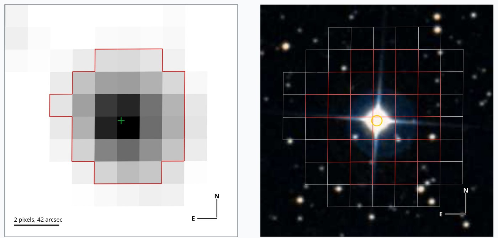
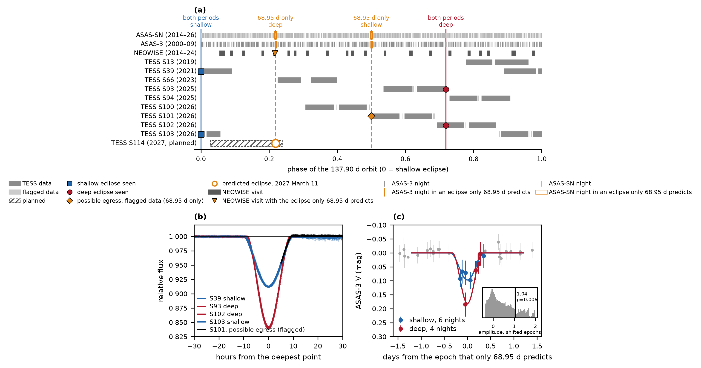

# HD 170312: a bright eclipsing binary with a period of 69 or 138 days

[](https://doi.org/10.5281/zenodo.24110891)

[Português](README.pt-BR.md)

HD 170312 is a relatively bright star in the far southern sky, with an apparent visual magnitude of V = 8.7, within reach of binoculars and modest telescopes, about 850 light-years from Earth. It has been catalogued as a single star, but photometry from the [TESS](https://science.nasa.gov/mission/tess/) space telescope shows that it is a pair: an evolved F-type primary, substantially larger than the Sun, and a companion star. I refer to the F star as HD 170312 A and to its companion as HD 170312 B. The pair orbit each other nearly edge-on as seen from Earth, so each passes in front of the other in turn, causing a dip in brightness of 8 to 15 percent that lasts most of a day. The passes come weeks to months apart, so they are easy to miss: no variable-star catalog, the TESS and Gaia ones included, lists the star as an eclipsing binary.



> Left: HD 170312 in the TESS pixels of sector 13, each 21 arcseconds across. The red line outlines the photometric aperture, the pixels of the TESS camera whose light is summed into the star's light curve, and the green cross is the star. Right: the same 3.6 arcminutes of sky in the Digitized Sky Survey, with the TESS pixels outlined and the star's position marked by the yellow ring. Photograph: [Digitized Sky Survey](https://archive.stsci.edu/dss/acknowledging.html), STScI, via CDS.

A search with [transitgpu](https://github.com/mauri870/transitgpu), a library I wrote to speed up the search for periodic dips in light curves on a GPU, flagged the star in data from NASA's TESS space telescope. TESS measured its brightness every two minutes over nine stretches of about a month each, between 2019 and 2026. In that data the star dimmed four times, by 8 to 15 percent for 16 to 18 hours each. The fourth dip lies in measurements the pipeline flags for scattered light, which its standard light curve leaves out. The search's strongest peak, at 12.9 days, is a spacing of the eclipses and not the orbital period.

The dimming comes from the HD 170312 system itself: the TESS images place it within 2.2 arcseconds of the star, and the stars around it are too faint to dim it this much. Only two orbital periods fit the four eclipses, 68.95 and 137.90 days. Of 3,200 periods tested, every other one predicts an eclipse where TESS saw none or misses one it saw. Three observations favour 68.95 days, none of them decisively. Flagged measurements at the start of TESS sector 101 rise like the end of an eclipse, at the time that only 68.95 days predicts. Older data from the [ASAS-3](https://www.astrouw.edu.pl/asas/) survey, taken from 2000 to 2009, show the star fainter on the ten nights that only 68.95 days places in eclipse, with a chance probability of about 1 percent. A visit of the [NEOWISE](https://www.nasa.gov/mission/neowise/) infrared satellite in September 2014 caught the star fading by 0.13 magnitudes at the time of an eclipse that only 68.95 days predicts, while the stars around it stayed steady. Photometry from ASAS-SN, 2014 to 2026, does not support 68.95 days.

On the night of 2026 December 1 to 2 only 68.95 days predicts an eclipse, centred at 04:43 UT. If that period is right, HD 170312 will be about 8.5 percent fainter, which a small telescope in the southern hemisphere can measure, although the star is low in the sky at that hour. A deeper eclipse on 2027 March 11, at BTJD 4475.8152, would settle the period: TESS observes the star then, in sector 114, and only 68.95 days predicts it.

The eclipses also tell us about the two stars. The brighter star, A, is an evolved F star of about 6,600 K and about 3.5 times the Sun's radius in the TESS Input Catalog. Models of two eclipsing stars fitted to the eclipses need A to be 24 to 34 percent smaller than that. The catalog counts all the system's light as A's, which makes its radius too large, but whether that accounts for the whole difference is not known. The models fit the eclipses equally well at both periods, so the shapes of the eclipses cannot choose between them. The eclipses block 8.5 and 15 percent of the system's light, so the companion, B, must be at least 0.95 times the Sun's radius with the catalog radius of A, and at least 0.62 with the smallest radius of A the models allow, far larger than any planet or brown dwarf, which reach about 0.2. These are lower bounds: the eclipses are rounded, as when one star only grazes the other, and B's own light makes the dips shallower. The eclipses also come in two depths, one for each star passing in front, which means B gives off light of its own. The deep eclipse does not fall halfway between two shallow ones, so the orbit is eccentric: at least 0.10 if the period is 68.95 days, at least 0.34 if it is 137.90.

This repository downloads the public data and reproduces the main numbers of the Research Note in `note/`. Preprint: [doi:10.5281/zenodo.24110891](https://doi.org/10.5281/zenodo.24110891).



> Figure 1 of the Note, drawn by `hd170312 figure`. (a) The part of the orbit each instrument observed, folded at 137.90 days with 0 at the shallow eclipse: solid lines mark the eclipses both remaining periods predict, dashed orange lines the eclipses only 68.95 days predicts. Orange marks are the observations that fall on those, and hollow orange boxes the ASAS-SN nights in those windows, whose test is undecided. The marks show when data exist, not whether the star was fainter. Markers show the eclipses seen, the possible egress of sector 101 and the predicted eclipse of 2027 March 11. (b) The four eclipses TESS recorded, aligned on their deepest point, and, in black, a possible egress of a fifth in the flagged data at the start of sector 101. (c) ASAS-3 nightly means on the ten nights that only 68.95 days places in eclipse and, in grey, the other nights, with the shapes of the TESS eclipses. Inset: the same fit at 20,000 shifted eclipse times, 0.6 percent of which reach the measured 1.04 times the TESS depths.

Requires uv, Python 3.13, network access for `fetch`, and tectonic for `note` only.

```
uv sync --locked
uv sync --locked --group search
uv run hd170312 fetch
uv run hd170312 all
uv run hd170312 verify
uv run hd170312 note
```

`verify` recomputes the Note's main numbers from the downloaded data and checks each against the value the Note states (claims.toml). It exits with status 1 if one fails. A few numbers of the Note come from analyses this repository does not include: where the dimming lies on the sky (within 2.2 arcseconds of the star) and the Gaia neighbours, the pixel-by-pixel and background tests of the fourth eclipse, the five comparison stars of the sector 101 egress, the searches of the spectrum archives, and the two-star fits (their equal fit at both periods, the 24 to 34 percent smaller radius of A and its smallest value, 2.27 solar radii, which the radius bound takes as an input).

`uv run pytest` runs offline tests on small fixtures. `uv run hd170312 COMMAND --help` describes each command.

## Other telescopes and archives

### Catalogs

No catalog lists HD 170312 as an eclipsing binary. These were searched on 2026 November 9:

| Catalog | What it holds for HD 170312 |
|---|---|
| [AAVSO Variable Star Index](https://www.aavso.org/vsx/) | no object within 60 arcseconds |
| ASAS-3 catalog of variable stars | not listed |
| [TESS eclipsing binary catalog](https://tessebs.villanova.edu/) (Prša et al. 2022) | a page for the star with no eclipsing-binary entry; the catalog uses the first 26 TESS sectors, and the star's only one of those, sector 13, holds no eclipse |
| [Gaia](https://www.cosmos.esa.int/web/gaia) DR3 variability tables | no row |
| [SIMBAD](https://simbad.harvard.edu/simbad/sim-id?Ident=HD+170312) | a single star of type F3 IV/V, with 4 references |
| [ExoFOP](https://exofop.ipac.caltech.edu/tess/target.php?id=292292315) | no TESS Object of Interest |
| [Planet Hunters TESS](https://www.zooniverse.org/projects/nora-dot-eisner/planet-hunters-tess/talk/2112/2092270) (Eisner et al. 2021) | volunteers tagged it #eclipsingbinary: mhuten, TaxiCab1729 and apalsikar from the sector 39 eclipse in August 2021; [ATarr in June 2026](https://www.zooniverse.org/projects/nora-dot-eisner/planet-hunters-tess/talk/2112/4050852) with primary eclipses in sectors 93 and 102, secondary eclipses in sectors 39 and 103 and #eccentric-eb; [gulpfumetti in July 2026](https://www.zooniverse.org/projects/nora-dot-eisner/planet-hunters-tess/talk/2112/4086339) with a minimum period of 36 days. None gave the period. The Note states their tags; the star was found independently of them |
| TESS variability catalog ([Fetherolf et al. 2023](https://doi.org/10.3847/1538-4365/acdee5)) | a 1.43-day signal of 94 parts per million in sector 13, far smaller than the eclipses |

NASA's TESS pipeline (SPOC) did notice the dips. Its automated searches flagged the star seven times, each time with one transit on one of the eclipses and a period between 8.8 and 1,477 days. None of those periods is one of the two that fit all four eclipses, and none of the flags became a TESS Object of Interest.

### A second reduction of the TESS data (QLP)

The [Quick-Look Pipeline](https://archive.stsci.edu/hlsp/qlp) makes its own light curves from the TESS full-frame images. It shows the same eclipses, with depths within 1.6 percentage points of SPOC's. Its time for the eclipse of sector 39 agrees with SPOC's within 0.6 combined errors. It also shows the fourth eclipse in sector 93, at 1.04 to 1.12 times the depth of the deep eclipse of sector 102. QLP's times for sectors 99 to 104 carry a known error in the barycentric correction and are being redelivered ([MAST](https://archive.stsci.edu/hlsp/qlp)), so only sector 39 is compared.

### ASAS-3, 2000 to 2009

The [All Sky Automated Survey](https://www.astrouw.edu.pl/asas/) measured the star about every two days. An eclipse lasts most of a day, so each eclipse holds one point or none, and no single eclipse is seen whole. The tests therefore pool the points that fall in predicted eclipses. Over the eclipses of the 137.90-day period, the star is fainter by 1.03 times the TESS depths, with a chance probability of 0.011. On the ten nights that only the 68.95-day period places in eclipse, it is fainter by 1.04 times the TESS depths, with p = 0.006 over 20,000 random shifts of the eclipse times, or 0.012 if no shift is excluded. The rule of that test was written before it was run, but after the same points had been examined in other ways. Each deficit is a single point, so ASAS-3 leans toward 68.95 days without deciding.

### ASAS-SN, 2014 to 2026

At V = 8.7 the star saturates the detectors of the [All-Sky Automated Survey for Supernovae](https://asas-sn.osu.edu/). Its standard photometry scatters by 0.06 to 0.16 magnitudes from night to night, depending on the camera, which is too much for this test. ASAS-SN also offers photometry of saturated stars made with machine learning ([Winecki & Kochanek 2024](https://doi.org/10.3847/1538-4357/ad5a0b)), with 1,523 measurements from four cameras, which make 1,410 camera-nights (a camera-night is the mean of one camera's measurements on one day). In it the star is fainter at the eclipses both periods predict, with p < 0.00005 over shifted eclipse times, by 2.07 times the TESS depths; why it is deeper is not known. On the 14 camera-nights that only 68.95 days places in eclipse, it is fainter by 0.89 ± 0.37 times the TESS depths, with p = 0.031, which the rule fixed beforehand counts as undecided, so ASAS-SN does not support 68.95 days. From late 2025 each camera's measurements drift by about 0.4 magnitudes, each on its own date, while TESS stays flat. That drift is instrumental. Without the data from 2025 August on, a check made after the drift was seen, the star is still fainter at the eclipses both periods predict (p < 0.00005), and on the 12 camera-nights that only 68.95 days places in eclipse it is fainter by 1.00 ± 0.18 times the TESS depths (p = 0.001). ASAS-SN has one camera-night at the possible egress of sector 101: it is 0.01 magnitudes fainter than the same camera's nights of the surrounding month, against 0.09 expected, with an error of 0.05, so it neither shows nor excludes that eclipse.

### NEOWISE, 2014

[NEOWISE](https://www.nasa.gov/mission/neowise/), a NASA infrared satellite, observed the star in 28 short visits from 2014 to 2024. Only one visit falls on a predicted eclipse: 2014 September 23 to 24, on a deep eclipse that only 68.95 days predicts. In the W2 band, at 4.6 micrometres, the star fades by 0.13 magnitudes and is faintest at the predicted time, to within the 95 minutes between exposures. None of the 11 other stars in the same frames, one of them as bright as HD 170312, fades by more than 0.02 magnitudes, and none of the star's 22 other visits with 12 or more exposures dips by more than 0.032 magnitudes. The fading follows the predicted eclipse in time and not the star's position on the detector, and no frame carries a saturation or artefact flag. No visit falls on an eclipse that both periods predict, so the test has no control. The visit was found after the period analysis, so it favours 68.95 days without establishing it.

### Archives with nothing to add

- SuperWASP: the public archive at the [NASA Exoplanet Archive](https://exoplanetarchive.ipac.caltech.edu/docs/SuperWASPMission.html) holds 7 points of the star over 6 days of 2006, with no predicted eclipse in that span.
- KELT: the [NASA Exoplanet Archive](https://exoplanetarchive.ipac.caltech.edu/docs/KELT.html) has no light curve of the star; its southernmost one is 2.2 degrees north of it.
- Spectra: [ESO](https://archive.eso.org/), NOIRLab, RAVE, GALAH, APOGEE-2 and Gaia-ESO hold no spectrum of the star. Gaia DR3 gives it no radial velocity, and SIMBAD lists none. The Gemini South and SALT archives could not be searched without an account. Without spectra, the masses of the two stars are unknown.

### Gaia DR4

Gaia's [fourth data release](https://www.cosmos.esa.int/web/gaia/dr4), expected in December 2026, will give brightness and radial-velocity measurements at each scan from 2014 July to 2020 January. ESA's scan forecast ([GOST](https://gaia.esac.esa.int/gost/)) gives 185 scans of HD 170312 in that span. None falls on an eclipse that only 68.95 days predicts, so Gaia's photometry cannot decide the period. Three scans on 2019 December 7 fall on a shallow eclipse that both periods predict, which checks the eclipse times in 2019. 104 scans cross the radial-velocity spectrometer, in 50 visits spread over the whole orbit. If DR4 publishes those velocities for this star, they could decide the period.

## Cite

Meneguzzo, M. de S. 2026, HD 170312: a bright eclipsing binary with a period of 69 or 138 days, preprint, [doi:10.5281/zenodo.24110891](https://doi.org/10.5281/zenodo.24110891).

```bibtex
@misc{Meneguzzo2026hd170312,
  author = {Meneguzzo, Mauri de Souza},
  title  = {HD 170312: a bright eclipsing binary with a period of 69 or 138 days},
  year   = {2026},
  note   = {Preprint},
  doi    = {10.5281/zenodo.24110891}
}
```

For the ASAS-3 data, also cite Pojmanski 1997, Acta Astronomica 47, 467.

## Licence

MIT, in `LICENSE`.
