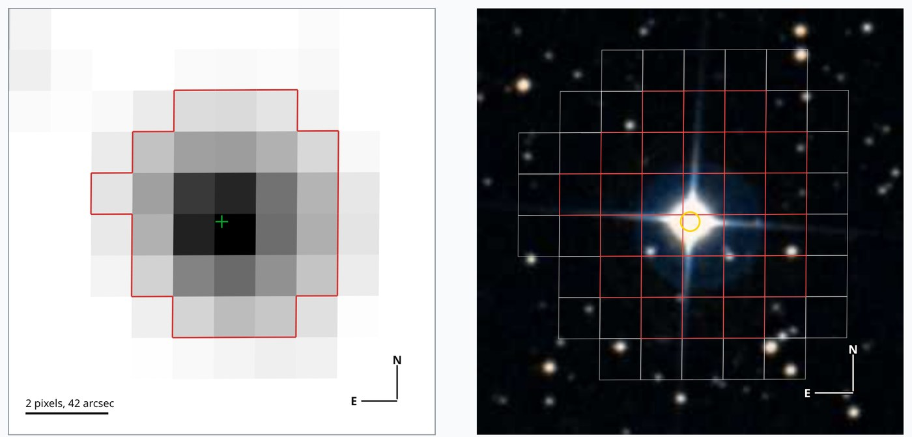
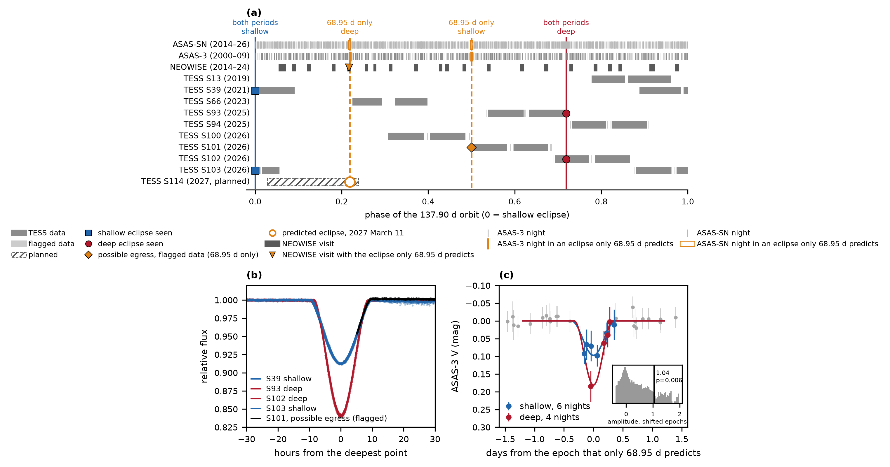

# HD 170312 é uma binária eclipsante brilhante e de longo período

[](https://doi.org/10.5281/zenodo.24110892)

[English](README.md)

HD 170312 é uma estrela relativamente brilhante no extremo sul do céu, com magnitude visual aparente V = 8,7, ao alcance de binóculos e de telescópios modestos, a cerca de 850 anos-luz da Terra. Ela vinha sendo catalogada como uma estrela simples, mas a fotometria do telescópio espacial [TESS](https://science.nasa.gov/mission/tess/) mostra que é um par: a componente primária, uma estrela F evoluída substancialmente maior que o Sol, e uma estrela companheira. Chamo a estrela F de HD 170312 A e a sua companheira de HD 170312 B. A órbita do par é vista quase de perfil a partir da Terra (inclinação próxima de 90°), de modo que cada estrela passa, alternadamente, na frente da outra, causando uma queda de brilho de 8 a 15 por cento que dura quase um dia. Os eclipses ocorrem com semanas a meses de intervalo e duram quase um dia, por isso passam facilmente despercebidos: nenhum catálogo de estrelas variáveis, incluindo os do TESS e do Gaia, classifica a estrela como binária eclipsante.



> À esquerda: HD 170312 nos pixels do TESS no setor 13, cada um com 21 segundos de arco. A linha vermelha contorna a abertura fotométrica, isto é, os pixels da câmera do TESS cuja luz é somada para formar a curva de luz da estrela, e a cruz verde marca a estrela. À direita: os mesmos 3,6 minutos de arco de céu no Digitized Sky Survey, com os pixels do TESS contornados e a posição da estrela marcada pelo anel amarelo. Fotografia: [Digitized Sky Survey](https://archive.stsci.edu/dss/acknowledging.html), STScI, via CDS.

Uma busca feita com o [transitgpu](https://github.com/mauri870/transitgpu), uma biblioteca que escrevi para acelerar em GPU a busca por quedas periódicas em curvas de luz, sinalizou a estrela nos dados do telescópio espacial TESS, da NASA. O TESS mediu seu brilho a cada dois minutos em nove setores de observação de cerca de um mês cada, entre 2019 e 2026. Nesses dados a estrela escureceu quatro vezes, de 8 a 15 por cento, durante 16 a 18 horas cada vez. O quarto eclipse está em medidas que o pipeline de redução sinaliza, por meio das flags de qualidade, como afetadas por luz espalhada, e que a sua curva de luz padrão exclui.

O escurecimento vem do próprio sistema HD 170312: as imagens do TESS o localizam no sistema, e as estrelas vizinhas são fracas demais para causar uma queda tão grande. Dados mais antigos do levantamento [ASAS-3](https://www.astrouw.edu.pl/asas/), obtidos de 2000 a 2009, mostram de forma independente HD 170312 mais fraca nos instantes previstos dos eclipses, numa quantidade semelhante à observada pelo TESS. Uma visita do satélite infravermelho [NEOWISE](https://www.nasa.gov/mission/neowise/) em setembro de 2014 registrou a estrela enfraquecendo 0,13 magnitude no instante de um eclipse que só uma órbita de 68,95 dias prevê, enquanto as estrelas ao redor permaneceram estáveis. Restam dois períodos orbitais, 68,95 e 137,90 dias. Na noite de 1 para 2 de dezembro de 2026 só o primeiro prevê um eclipse, centrado às 04:43 UT: se ele estiver certo, HD 170312 ficará cerca de 8,5 por cento mais fraca durante quase um dia, o que um pequeno telescópio no hemisfério sul consegue medir.

Os eclipses também informam sobre as duas estrelas. A mais brilhante, A, é uma estrela F evoluída, com temperatura efetiva de cerca de 6.600 K e cerca de 3,5 vezes o raio do Sol segundo o TESS Input Catalog. Os eclipses bloqueiam 8,5 e 15 por cento da luz do sistema, de modo que a companheira, B, deve ter pelo menos 0,62 vez o raio do Sol nas hipóteses menos favoráveis, e 0,95 com o raio de catálogo de A, muito maior que qualquer planeta ou anã marrom, que chegam a cerca de 0,2. Trata-se de limites inferiores: os eclipses têm o fundo arredondado, como num eclipse rasante, em que uma estrela apenas tangencia o disco da outra, e a própria luz de B torna as quedas mais rasas. Os eclipses têm ainda duas profundidades, uma para cada estrela que passa na frente, o que indica que B emite luz própria.

Este repositório baixa os dados públicos e reproduz os principais números da Research Note em `note/`. Preprint: [doi:10.5281/zenodo.24110892](https://doi.org/10.5281/zenodo.24110892).



> Figura 1 da Note, gerada por `hd170312 figure`. (a) A parte da órbita que cada instrumento observou, dobrada em 137,90 dias: as linhas contínuas marcam os eclipses que os dois períodos restantes preveem, e as tracejadas laranja os eclipses que só 68,95 dias prevê; as marcas laranja são as observações que caem sobre elas; laranja vazado: as noites do ASAS-SN nessas janelas, cujo teste é indeterminado. As marcas mostram quando há dados, não se a estrela estava mais fraca. (b) Os quatro eclipses registrados pelo TESS, alinhados pelo mínimo de cada eclipse, e, em preto, uma possível saída de eclipse de um quinto nos dados sinalizados do início do setor 101. (c) Medidas do ASAS-3 nos instantes que só o período de 68,95 dias prevê.

Requer uv, Python 3.13, acesso à rede para `fetch` e tectonic apenas para `note`.

```
uv sync --locked
uv sync --locked --group search
uv run hd170312 fetch
uv run hd170312 all
uv run hd170312 verify
uv run hd170312 note
```

`verify` recalcula os principais números da Note a partir dos dados baixados e confere cada um com o valor que a Note declara (claims.toml). Encerra com status 1 se algum falhar. Alguns números da Note vêm de análises que este repositório não inclui: onde o escurecimento está no céu (a menos de 2,2 segundos de arco da estrela) e as vizinhas do Gaia, os testes pixel a pixel e de fundo do quarto eclipse, e os ajustes de duas estrelas (o raio de A de 24 a 34 por cento menor e seu menor valor, 2,27 raios solares, que o limite de raio usa como entrada).

`uv run pytest` executa testes offline com dados de teste pequenos. `uv run hd170312 COMANDO --help` descreve cada comando.

## Outros telescópios e arquivos

### Catálogos

Nenhum catálogo lista HD 170312 como binária eclipsante. Estes foram consultados em 9 de novembro de 2026:

| Catálogo | O que contém sobre HD 170312 |
|---|---|
| [AAVSO Variable Star Index](https://www.aavso.org/vsx/) | nenhum objeto a menos de 60 segundos de arco |
| Catálogo de estrelas variáveis do ASAS-3 | não listada |
| [Catálogo de binárias eclipsantes do TESS](https://tessebs.villanova.edu/) (Prša et al. 2022) | uma página da estrela, sem entrada de binária eclipsante; o catálogo usa os 26 primeiros setores do TESS, e o único deles com a estrela, o setor 13, não contém eclipse |
| Tabelas de variabilidade do [Gaia](https://www.cosmos.esa.int/web/gaia) DR3 | nenhuma linha |
| [SIMBAD](https://simbad.harvard.edu/simbad/sim-id?Ident=HD+170312) | uma estrela simples de tipo F3 IV/V, com 4 referências |
| [ExoFOP](https://exofop.ipac.caltech.edu/tess/target.php?id=292292315) | nenhum TESS Object of Interest |
| Catálogo de variabilidade do TESS ([Fetherolf et al. 2023](https://doi.org/10.3847/1538-4365/acdee5)) | um sinal de 1,43 dia e 94 partes por milhão no setor 13, muito menor que os eclipses |

O pipeline do TESS da NASA (SPOC) percebeu as quedas. Suas buscas automáticas sinalizaram a estrela sete vezes, cada vez com um trânsito sobre um dos eclipses e um período entre 8,8 e 1.477 dias. Nenhum desses períodos é um dos dois que se ajustam aos quatro eclipses, e nenhum desses sinais virou um TESS Object of Interest.

### Uma segunda redução dos dados do TESS (QLP)

O [Quick-Look Pipeline](https://archive.stsci.edu/hlsp/qlp) produz suas próprias curvas de luz a partir das imagens de quadro completo do TESS. Ele mostra os mesmos eclipses, com profundidades a no máximo 1,6 ponto percentual das do SPOC. Seu instante para o eclipse do setor 39 concorda com o do SPOC dentro de 0,6 erro combinado. Ele também mostra o quarto eclipse no setor 93, com 1,04 a 1,12 vez a profundidade do eclipse profundo do setor 102. Os instantes do QLP dos setores 99 a 104 têm um erro conhecido na correção baricêntrica e estão sendo reprocessados ([MAST](https://archive.stsci.edu/hlsp/qlp)); por isso só o setor 39 é comparado.

### ASAS-3, 2000 a 2009

O [All Sky Automated Survey](https://www.astrouw.edu.pl/asas/) mediu a estrela a cada dois dias, aproximadamente. Um eclipse dura a maior parte de um dia, então cada eclipse contém um ponto ou nenhum, e nenhum eclipse aparece inteiro. Por isso os testes combinam os pontos que caem nos eclipses previstos. Nos eclipses do período de 137,90 dias, a estrela está mais fraca por 1,03 vez as profundidades do TESS, com probabilidade de acaso de 0,011. Nas dez noites que só o período de 68,95 dias coloca em eclipse, ela está mais fraca por 1,04 vez as profundidades do TESS, com p = 0,006 em 20.000 deslocamentos aleatórios dos instantes dos eclipses, ou 0,012 se nenhum deslocamento for excluído. A regra desse teste foi escrita antes de ele ser executado, mas depois de os mesmos pontos terem sido examinados de outras formas.

### ASAS-SN, 2014 a 2026

Com V = 8,7, a estrela satura os detectores do [All-Sky Automated Survey for Supernovae](https://asas-sn.osu.edu/). A fotometria padrão dele varia de 0,06 a 0,16 magnitude de uma noite para outra, conforme a câmera, o que é demais para este teste. O ASAS-SN também oferece fotometria de estrelas saturadas feita com aprendizado de máquina ([Winecki & Kochanek 2024](https://doi.org/10.3847/1538-4357/ad5a0b)), com 1.523 medidas de quatro câmeras, que formam 1.410 noites-câmera (uma noite-câmera é a média das medidas de uma câmera em um dia). Nela a estrela está mais fraca nos eclipses que os dois períodos preveem, com p < 0,00005 em instantes de eclipse deslocados, por mais que as profundidades do TESS; não se sabe por que ela aparece mais profunda. Nas 14 noites-câmera que só o período de 68,95 dias coloca em eclipse, ela está mais fraca por 0,89 ± 0,37 vez as profundidades do TESS, com p = 0,031, o que a regra fixada de antemão classifica como indeciso. A partir do fim de 2025 as medidas de cada câmera derivam cerca de 0,4 magnitude, cada uma numa data própria, enquanto o TESS se mantém estável. Essa deriva é instrumental. Sem os dados de agosto de 2025 em diante, numa verificação feita depois de a deriva ser vista, a estrela continua mais fraca nos eclipses que os dois períodos preveem (p < 0,00005), e nas 12 noites-câmera que só o período de 68,95 dias coloca em eclipse ela está mais fraca por 1,00 ± 0,18 vez as profundidades do TESS (p = 0,001). O ASAS-SN tem uma noite-câmera na possível saída de eclipse do setor 101: ela está 0,01 magnitude mais fraca que as noites da mesma câmera no mês ao redor, contra 0,09 esperado, com erro de 0,05, então não mostra nem exclui esse eclipse.

### NEOWISE, 2014

O [NEOWISE](https://www.nasa.gov/mission/neowise/), um satélite infravermelho da NASA, observou a estrela em 28 visitas curtas entre 2014 e 2024. Só uma visita cai num eclipse previsto: 23 e 24 de setembro de 2014, num eclipse profundo que só o período de 68,95 dias prevê. Na banda W2, em 4,6 micrômetros, a estrela enfraquece 0,13 magnitude e atinge o mínimo no instante previsto, dentro dos 95 minutos entre exposições. Nenhuma das outras 11 estrelas dos mesmos quadros, uma delas tão brilhante quanto HD 170312, enfraquece mais que 0,02 magnitude, e nenhuma das outras 22 visitas da estrela com 12 ou mais exposições mostra queda maior que 0,032 magnitude. O enfraquecimento acompanha o eclipse previsto no tempo e não a posição da estrela no detector, e nenhum quadro tem marca de saturação ou de artefato. Nenhuma visita cai num eclipse que os dois períodos preveem, então o teste não tem controle. A visita foi examinada depois da análise dos períodos.

### Arquivos sem dados úteis

- SuperWASP: o arquivo público no [NASA Exoplanet Archive](https://exoplanetarchive.ipac.caltech.edu/docs/SuperWASPMission.html) tem 7 pontos da estrela em 6 dias de 2006, sem nenhum eclipse previsto nesse intervalo.
- KELT: o [NASA Exoplanet Archive](https://exoplanetarchive.ipac.caltech.edu/docs/KELT.html) não tem curva de luz da estrela; a mais ao sul fica 2,2 graus ao norte dela.
- Espectros: [ESO](https://archive.eso.org/), NOIRLab, RAVE, GALAH, APOGEE-2 e Gaia-ESO não têm espectro da estrela. O Gaia DR3 não dá velocidade radial para ela, e o SIMBAD não lista nenhuma. Os arquivos do Gemini South e do SALT não puderam ser consultados sem conta. Sem espectros, as massas das duas estrelas são desconhecidas.

### Gaia DR4

A [quarta divulgação de dados](https://www.cosmos.esa.int/web/gaia/dr4) do Gaia, prevista para dezembro de 2026, trará medidas de brilho e de velocidade radial em cada varredura de julho de 2014 a janeiro de 2020. A previsão de varreduras da ESA ([GOST](https://gaia.esac.esa.int/gost/)) dá 185 varreduras de HD 170312 nesse período. Nenhuma cai num eclipse que só o período de 68,95 dias prevê, então a fotometria do Gaia não decide o período. Três varreduras em 7 de dezembro de 2019 caem num eclipse raso que os dois períodos preveem, o que verifica os instantes dos eclipses em 2019. Das varreduras, 104 passam pelo espectrômetro de velocidade radial, em 50 visitas espalhadas pela órbita inteira. Se o DR4 publicar essas velocidades para esta estrela, elas poderão decidir o período.

## Como citar

Meneguzzo, M. de S. 2026, HD 170312 is a bright, long-period eclipsing binary, preprint, [doi:10.5281/zenodo.24110892](https://doi.org/10.5281/zenodo.24110892).

```bibtex
@misc{Meneguzzo2026hd170312,
  author = {Meneguzzo, Mauri de Souza},
  title  = {HD 170312 is a bright, long-period eclipsing binary},
  year   = {2026},
  note   = {Preprint},
  doi    = {10.5281/zenodo.24110892}
}
```

Para os dados do ASAS-3, cite também Pojmanski 1997, Acta Astronomica 47, 467.

## Licença

MIT, em `LICENSE`.
